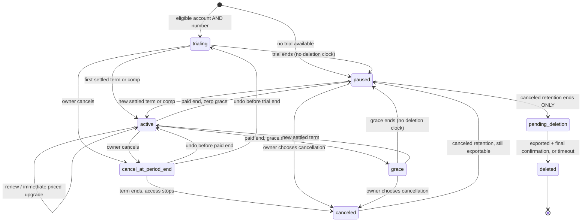

# Phase 7 Part 4 — plans, subscriptions and manual billing

**Scope:** opt-in platform subscription billing only. No payment processor/SDK, real credentials, card entry, AI adjudication, money movement or Part 5. See [operator confirmation and rollout](manual-billing-operations.md). The shop's WhatsApp order/payment-review database remains separate.

## What determines access

| Concept | Source of truth | What it does **not** prove |
|---|---|---|
| Plan | Operator-published immutable `b_plan` version: caps, feature allowlist, currency, offers by duration | A price or selected plan does not buy a term. |
| Subscription | `b_sub` plus ordered term/change/cancel events. A reversal references its original grant; later grants are replayed. | A free trial, extension or comp is not revenue. |
| Money | `b_review` is the claim. **Only confirmed money** creates `b_payment`; a separate `b_reversal` offsets it. `b_confirmed` excludes reversed credits. Refunds are records only. | Uploads, consistent checks, quotes and unpaid invoices are not payments. |
| Entitlement | **`entitlementsFor(tenant, now)`** projects the state, purchased version, end, future version, flags, caps, retention dates and permission to run. | An old `tenants.plan_id`, feature setting or worker process isn't authority to run. |

`canceled` identifies the first UTC-duration day after cancellation takes effect; `paused` during the remainder carries the cancellation deadline. Ordinary trial expiry and ordinary unpaid pause have **no** deletion deadline. Canceling a long-paused assistant starts retention **now**, not retroactively. The retention and final-wait settings are captured at cancellation. Buying another term before destruction clears the cancellation clock. A reversal projects whichever state the surviving events support; it does not blindly subtract one month or delete data. The transition trail is append-only while the subscription exists; explicit forget removes linkable history and leaves only monthly churn counts, plus optional anonymous accounting totals.

- **Dates:** first purchased term starts on confirmation. A renewal starts at `max(confirmation time, current paid end)`. UTC time of day is preserved, and the target day is clamped (Jan 31 → Feb 28/29). Timezone display handles DST without changing the stored instant. The currently purchased version is sticky; paying early for the next version does not silently activate it today. A higher tier takes a separate operator-priced difference for the remaining term; a scheduled lower tier doesn't itself buy more time.
- **Accounting:** one integer totals function; tax uses integer basis points and `BigInt` rounding. Formatting uses explicit minor-unit exponents, **not** cash-display rounding (notably PKR). Quotes, invoices and receipts have independent sequential UTC-year numbers. Each confirmation has one primary key, receipt and delivery intent. A full invoice grants its period in that same synchronous SQL transaction. PDF creation, worker changes and mail happen outside it. Dashboard downloads render from the financial records, not the current catalog price.
- **Worker:** the platform writes a private, atomically replaced lease, not payment data. The shared worker reader checks the actual isolated tenant identity, deadline and version boundary. Normal replies, proactive sends, Cloud buttons, missed-call rescue and retry/recovery paths cannot rely on an old launch-time plan. Worker-side caps reserve before provider work; agent/team lists, optional flags, history and reports consult the same projection. Existing safety/consent switches are not paid features. A stopped assistant still needs a ready worker to run; startup-only background jobs can require a normal worker restart.
- **Privacy:** bounded redacted text (4,096 characters), PNG/JPEG/PDF (2 MiB; raster dimensions capped); short-lived local readers only. The private `0700` evidence directory contains `0600` masked field copies, not original pixels, executable PDFs, filenames or arbitrary OCR text. Copies expire and are purged, along with identifying checks/fingerprints. Duplicate checks use hashes/keyed reference equality. The operator sees evidence provenance, checks and neutral reasons, not customer chat. Staff are read-only with financial details withheld. Deletion clears receipts, claims, source links, private dev mail and tenant data using the existing forget path. Anonymised accounting, if enabled, keeps month/currency totals, not individual receipts.

## Verification on synthetic data

| Check | Result |
|---|---|
| `npm test` with local ffmpeg available | **1,346 passed**, 0 failed, 0 skipped (172.34 s). The pre-billing baseline was 1,317; existing test files were not edited. |
| New billing suites | **29 tests** across ledger, lifecycle/worker and HTTP. Includes real provisioning, DB close/reopen, parallel confirmations over HTTP, partial/reversal/regrant, sticky plan version, both calendar and cancellation boundaries, restart notices, deletion vs concurrent renewal, retention/erasure, IDOR/role/CSRF, file limits and permissions, fake webhook replay and wrong amount/currency. |
| `npm run eval` | **110/110** chat scenarios (212 recorded turns, 0 warnings/failures); **18/18** media cases (27 recorded turns + 10 TTS replays). No network. |
| 390 × 844 Chromium billing | Real HTML, cookies, Basic login, CSRF and API. Select a two-month offer, upload a generated PDF, read its extracted fields as operator, confirm part, submit/confirm balance, download receipt, cancel/resume, check staff view and operator filter. **Passed**; no page errors or external requests. |
| Existing Chromium dashboard | Customer report pages, scoped export, staff denials and separate operator view passed with billing off. |
| Worker delivery | Real `deliverKeysAtStart` → isolated supervisor launch environment → local child reading the lease. Then hot feature/limit changes, outage cutoff, silent/opt-in handover and owner reminder tested with synthetic transport. No actual WhatsApp session. |
| `doctor -- platform` | Disposable DB, actual CLI: absent instructions, paid offers and production mailer warned. After publishing fake settings/offers only the mail warning remained of those three. |

Reproduce with `npm test`, `npm run eval`, or `node --test test/{80,81,82}-billing-*.test.js`. For both phone runs, point `PLAYWRIGHT_MODULE` at an installed `playwright-core` ESM entry and `CHROMIUM_BIN` at offline Chromium; run `node test/browser/billing.mjs` and `node test/browser/dashboard.mjs`. The fixtures use temporary platform/worker roots and locally generated credentials; there is no seed transfer account to charge. The optional media binary and browser are test environment tools, not new package dependencies.

## Changed files relative to the preceding media commit

| Area | Files |
|---|---|
| Financial model and commands | `platform/billing/{schema,rules,catalog,subscriptions,payments,audit}.js`, `platform/public/billing-money.js` |
| Proof, expiry, privacy and views | `platform/billing/{proofInput,pdfText,proofs,leases,jobs,privacy,overview,routes}.js` |
| Platform wiring | `platform/{db,env,index,routes,accounts,provisioning,plans,keys,wizard,connect,onboarding,settings,mailer,diagnostics}.js` |
| Customer/operator surfaces | `platform/{reportRoutes,reportView}.js`, `platform/public/{app,billing}.js`, `platform/public/billing.css` |
| Worker and reuse | `src/boot.js`, `src/config/env.js`, `src/core/llm.js`, `src/handlers/messageHandler.js`, `src/transport/baileys.js`, `src/services/{billingLease,billingMeter,agents,calls,decisionTeam,ffmpeg,mediaLimits,paymentProofs,privacy,profile,reportContract,tenantReports,transcription,tts}.js` |
| Verification | `test/{80-billing-ledger,81-billing-lifecycle,82-billing-http}.test.js`, `test/fixtures/billing.js`, `test/browser/billing.mjs` |
| Documentation/config | `.env.example`, `README.md`, `docs/manual-billing-operations.md`, this report |

## What the tests cannot establish

A proof or successful fake event cannot establish that a **real bank credit settled**, belongs to this invoice, or won't later reverse. Only the receiving ledger and a human reconciliation can do that. First-page PDF text was exercised; raster fields can need owner transcription when optional local Tesseract is absent. Neither transcription nor OCR authenticates an image. Original opaque binaries are deliberately not retained for later visual forensics.

A generated PDF, private file mail and a recording HTTP adapter verify receipt identity, attachment construction and retry keys — **not** production mail acceptance, delivery, attachment rendering, spam filtering or receipt by the intended person. Email retries rely on the real adapter honouring idempotency. WhatsApp reminders are best effort on a connected worker and an allowed messaging window; crash/transport ambiguity is not proof of handset delivery. No real transfer, refund, mailbox, handset, external payment SDK, live webhook or AI adjudication was used.

The ledger assumes the repository's **single durable sql.js writer** and one process per tenant; these are not multi-primary/Postgres tests. Host/root compromise and external backups/mail copies are outside application-level erasure. The platform must be running to send notices or execute deletion; workers cannot extend access while it is offline. Set reviewed policies and test real delivery separately before production rollout.
